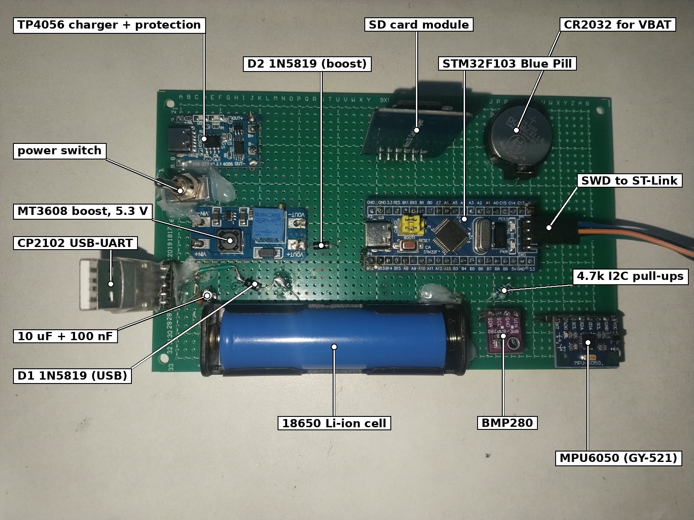
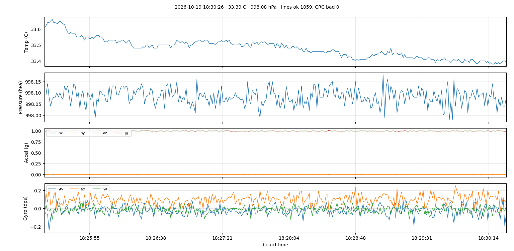
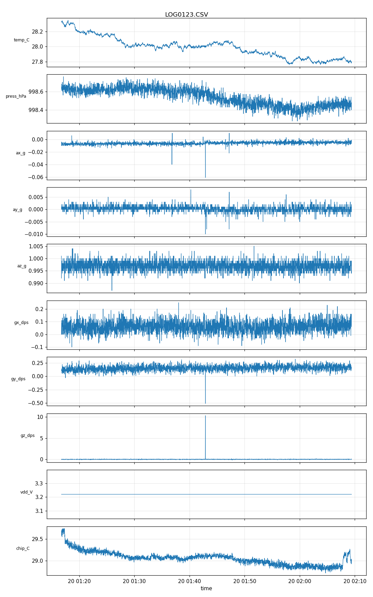

# RTOS-Based Sensor Data Logger on an STM32F103 (FreeRTOS, registers only)

Saman Fuyal, Department of Electrical and Electronics Engineering, Kathmandu University

A Blue Pill (STM32F103C8) reads a BMP280 (temperature, pressure) and an MPU6050 (acceleration,
rotation) once a second and writes each sample to a micro SD card as one CSV line with a CRC-32
at the end. It also logs the chip's own temperature and its supply voltage. The firmware runs on
FreeRTOS and is written on the registers, without HAL. Between samples the chip sleeps in STOP
mode, and the RTC alarm wakes it 1 ms before the next sample is due. The finished board runs from
an 18650 cell with a TP4056 charger and an MT3608 boost converter, and a CR2032 keeps the clock
running while the power is off. With a CP2102 connected there is a command line at 115200 baud.



```
BMP280  --+                                  +-- SPI1 ----- SD card (FatFs, LOGnnnn.CSV)
          +-- I2C1 100 kHz --+  STM32F103C8  |
MPU6050 --+                  +-- FreeRTOS ---+-- USART1 --- CP2102 -- PC (commands, live plot)
32.768 kHz crystal + CR2032 -- RTC 1024 Hz   +-- PB12 ----- test point (logic analyzer)
18650 -> TP4056 -> switch -> MT3608 5.3 V -> 1N5819 -> 5V  (USB 5V through a second 1N5819)
```

Tasks: Sensor (priority 3) takes a sample every `rate` ms and puts it in a queue of 8. Logger
(priority 2) turns it into a CSV line, prints it and writes it to the card. Cli (priority 1) runs
the commands. A start-up task checks every part at power-on and then deletes itself.

Tools: STM32CubeIDE or arm-none-eabi-gcc with the Makefile, ST-Link V2, PuTTY, Python 3 with
pyserial and matplotlib, EasyEDA Standard for the schematic. `COMMANDS.md` lists every command
in order. The full report is `docs/report/report.pdf` (IEEE conference layout, two columns);
`docs/report/build_report.py` rebuilds it, with its block diagrams and plots, from the files in
`results/`.

## Results



Timing, from a 51-minute run at 1 sample/s with STOP mode on (`results/timing.md`):

| Measurement | Result |
|---|---|
| Sample period, firmware's own clock | 999 998 to 1 000 002 us over 3056 samples (±2 us) |
| Sample period, against the RTC crystal | 1.0016 s (5 stamps skip a second in 3158 s, see below) |
| Sensor read (BMP280 + MPU6050 + ADC) | 24.2 ms, spread 1 us |
| Building the CSV line and its CRC | 1.3 to 1.4 ms |
| Handing the line to the UART (DMA) | 2.5 ms |
| SD write | 0.26 ms buffered, 42 ms when FatFs syncs (every 10 lines) |
| Sample taken to line on the card | 28.5 ms |
| Log file LOG0123.CSV | 3154 lines, CRC bad 0, no gaps |
| Records dropped, lowest free heap | 0, 1520 B of 10 240 B |

Board current at the 5 V input, breadboard, 1 sample/s (`results/current_measurements.md`):

| Mode | Current |
|---|---|
| `power run` (CPU never sleeps) | 17.62 mA |
| `power sleep` (WFI between tasks) | 12.94 mA |
| `power stop` (STOP between samples) | 9.3 mA |
| STOP, not logging | 9.1 mA |
| STOP, not logging, MPU6050 asleep | 7.92 mA |

STOP mode cuts the board current by 47 %. The chip is in STOP about 96 % of the time when nobody
types. What is left is mostly the modules: the SD module's regulator, the MPU6050 and the power
LEDs. From a 2500 mAh 18650 through the boost converter this gives about 7 days in STOP mode
against about 3.7 days in run mode.

These are not low currents for a battery logger: loggers built for long deployments sleep at
12 uA to 0.2 mA. This board uses ready-made modules that stay powered, so the result here is
what the firmware saves, not a low-current board (see the report, Section II).

Matrix board (rev B): runs from the 18650 alone or from the CP2102, charges over USB-C while it
logs, and the CR2032 kept the clock correct through a 2-minute power-off.



### Problems found on the way

The first STOP-mode version woke up only through the RTC alarm interrupt and never woke on the
CubeIDE build. The watchdog reset the board every 26 s. The vector table in the .elf showed why:
CubeIDE's startup file names vector 41 `RTCAlarm_IRQHandler`, the code defined
`RTC_Alarm_IRQHandler`, so the alarm went to `Default_Handler`. The wake-up now uses EXTI events
with WFE, which need no handler at all.

The chip temperature and VDD froze about 2 minutes after power-on (first seen in an 18-minute
log). The ADC was left converting in the background and stopped after the first STOP. A restart
of the conversions alone gave `nan`. Each reading now resets the ADC through RCC, calibrates it,
takes 32 pairs with DMA and switches it off again. The 51-minute log above was taken after this
fix.

VDD read 3.21 V where the multimeter showed 3.22 V. The internal reference was 1.1695 V instead
of the nominal 1.20 V, and the value was cut off instead of rounded. The `vddcal` command now
measures the reference against a meter reading, and VDD is rounded.

Flashing from CubeIDE failed with "Error finishing flash operation" once the board slept. The
debug configuration used "Connect under reset", which needs the NRST wire that the 3-wire
ST-Link cable does not have. "Software system reset" fixed it. Setting BOOT0 to 1 is the fallback.

### Known issue: the sample period is 0.16 % long

LOG0123.CSV runs from 01:16:46 to 02:09:24, 3158 s, but has 3154 lines. Five times the time
stamp jumps by 2 s instead of 1 s, after data lines 74, 725, 1376, 2062 and 2749: every 651 to
687 samples, so it is a steady drift, not lost samples. The real period is therefore about 1.0016 s.
The `timing` command cannot see this because it measures with the same FreeRTOS tick that
schedules the samples. The time stamps come from the RTC crystal and are correct; the scheduler's
time is what runs slow.

The cause is not confirmed. The place to look is `power_idle()`, where the time spent in STOP is
handed back to the tick. Three things there can make the tick differ from the RTC: SysTick is
stopped part-way through a millisecond and restarted from zero, so that part of a millisecond is
dropped at every STOP (tick slow); the RTC reading taken before STOP falls somewhere inside a
1/1024 s count while the wake-up comes exactly on a count (tick fast); and the time awake is
counted by the 8 MHz RC oscillator, which is only accurate to about 1 %. Two checks would
separate them: the logic analyzer test below, and a log taken in `power sleep` mode, where STOP
is never used. If the stamps stop skipping in sleep mode, the STOP hand-over is the cause.

### Not tested yet

- Sample period and sensor-read time measured from outside with a logic analyzer on the PB12
  test point. The firmware measures them with its own clock; the analyzer has not arrived.
- Current drawn from the 18650 on the matrix board, in each power mode.
- A long run on the battery alone, to check the 7-day estimate.
- The chip temperature offset (`tscal`): `TS_OFFSET_C100` is still 0, so `chip_C` reads about
  1 °C above the BMP280.
- A PCB. The schematic is drawn in EasyEDA; the PCB layout, its design rule check and 3D view
  are the next step if the project continues (`COMMANDS.md` section 7).

`COMMANDS.md` section 6 has the steps for each test.

## Folders

```
firmware/   the logger: src/ (all the C), startup/ (vector table, linker script), fatfs/ (FatFs R0.16),
            freertos/ (kernel V11.3.1), Makefile, README.md (tasks, low power, commands)
bringup/    nine small test programs, one per peripheral, in the order they were written
tools/      PC side: settime.py, live_plot.py, getfile.py (copy a file over USB), log_check.py
hardware/   pinout, matrix board notes, Schematic_STM32_DataLogger_FreeRTOS_2026-10-22.png (EasyEDA export)
docs/       photos/, captures/ (plots and screenshots), report/, MPU6050 calibration values
results/    timing, current measurements, the example 51-minute log LOG0123.CSV
```

## Quick start

1. Build `firmware/` in STM32CubeIDE (optimization -Os) or with `make`, flash with the ST-Link.
2. CP2102: TXD to PA10, RXD to PA9, GND, 5V. PuTTY at 115200 baud, type `help`.
3. Set the clock once: `python tools/settime.py COM5`. The board logs to `LOGnnnn.CSV` by itself
   from power-on.
4. In STOP mode the first key only wakes the console: press Enter once, then type.

## License

My code (firmware/src, bringup, tools, docs/report) is under the MIT License, see `LICENSE`.
FreeRTOS (firmware/freertos) is MIT licensed by Amazon, see `firmware/freertos/LICENSE.md`.
FatFs (firmware/fatfs) is by ChaN under its own BSD-style license, given at the top of `ff.c`.
