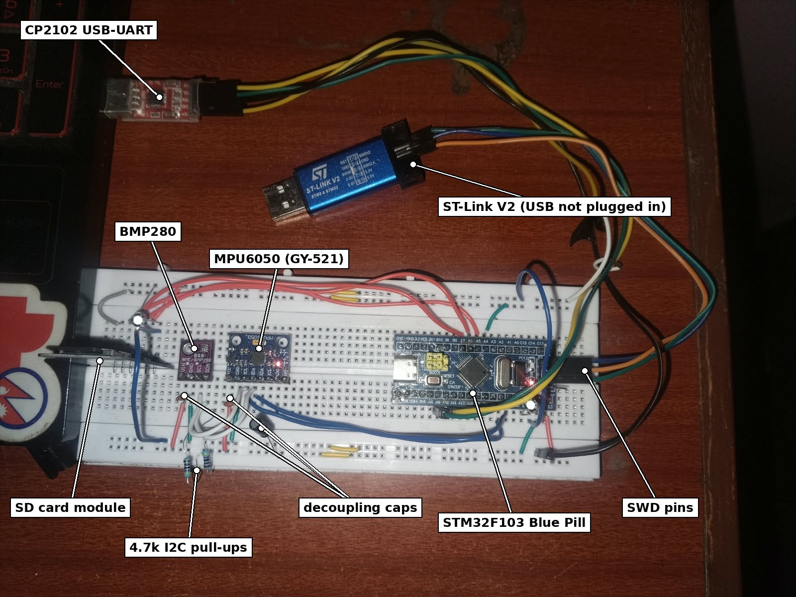
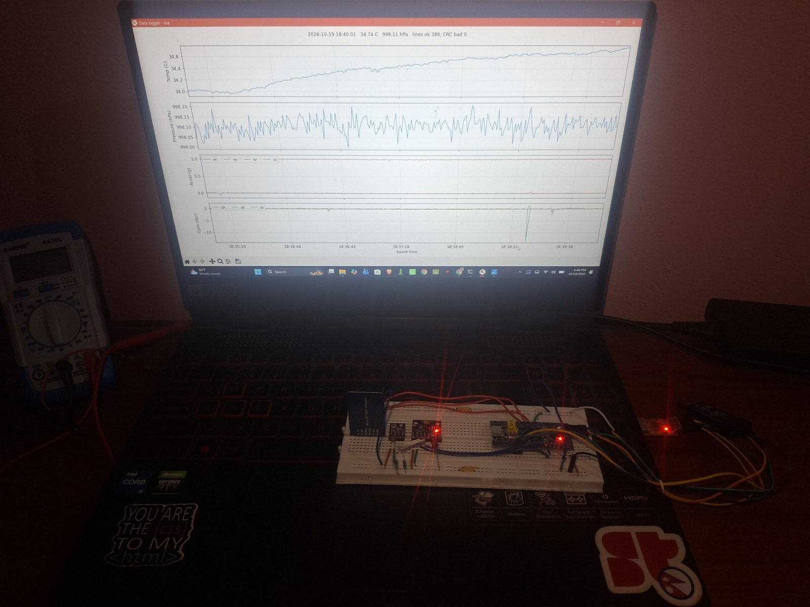
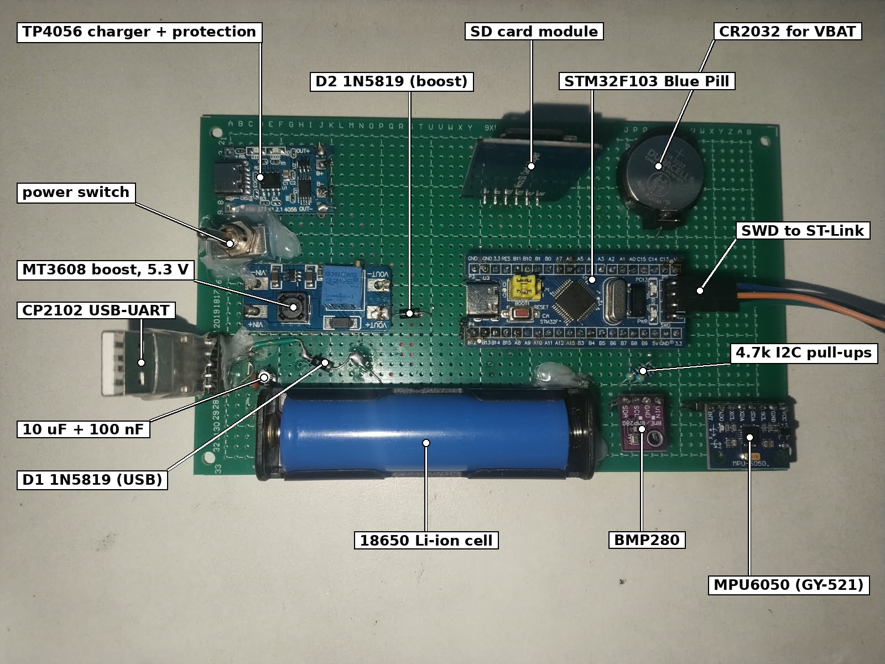
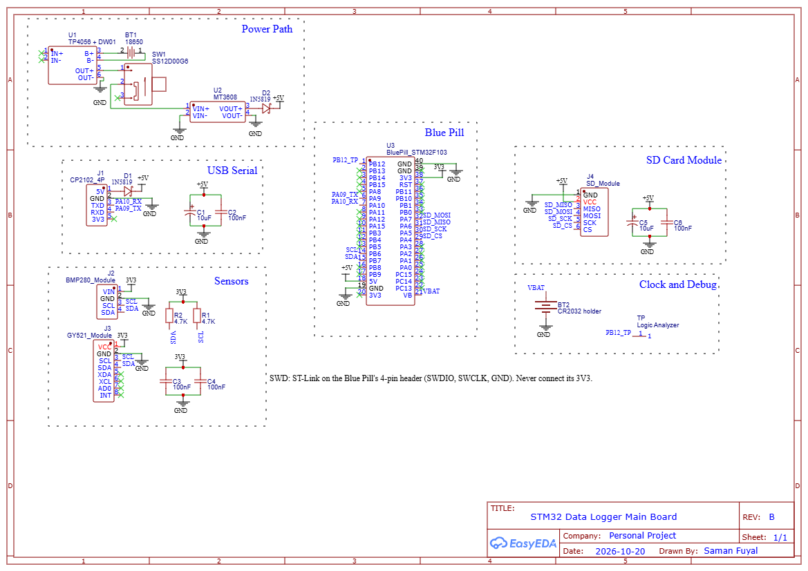

# Hardware

## Pins

```
signal    pin        to
UART TX   PA9        CP2102 RXD
UART RX   PA10       CP2102 TXD (internal pull-up, also EXTI 10 for the key wake-up)
I2C SCL   PB6        BMP280 + MPU6050 SCL, 4.7k to 3V3
I2C SDA   PB7        BMP280 + MPU6050 SDA, 4.7k to 3V3
SD CS     PA4        SD module CS
SPI SCK   PA5        SD SCK
SPI MISO  PA6        SD MISO
SPI MOSI  PA7        SD MOSI
LED       PC13       on-board LED (active low)
debug     PB12       test point, high while the sensors are read
VBAT      VB         CR2032 + (matrix board)
SWD       DIO/DCLK   ST-Link on the Blue Pill's 4-pin header (SWDIO, SWCLK, GND only)
```

The BMP280 module has no I2C pull-ups (measured), so R1 and R2 are needed. Sensors run from the
Blue Pill's 3V3; the SD module takes 5V because it has its own 3.3 V regulator and level shifter.

## Breadboard (rev A)





Power came from the CP2102's 5V. 10 uF at the SD module and at the Blue Pill 5V pin, 10 nF at
each sensor. No coin cell yet, so the clock went back to 1970 after every power-off. Flashing
while the board is in STOP: the ST-Link cannot connect, so press reset and flash within 10 s, or
type `power sleep` first.

## Matrix board (rev B)



Built and working on 31-10-2026. Runs from the 18650 alone or from the CP2102, charges over the
TP4056's USB-C while it logs, and the CR2032 keeps the clock through a power-off.



Changes from rev A:
- 18650 -> TP4056 + DW01 -> SW1 -> MT3608 (set to 5.3 V) -> D2 1N5819 -> +5V
- CP2102 5V through D1 1N5819, so USB and battery cannot push current into each other
  (battery gives about 5.0 V after the diode, USB about 4.7 V, so the battery side supplies the
  board while both are on)
- CR2032 in a holder on VB. VB to 3V3 was measured open first: on some Blue Pill clones they are
  joined, and 3.3 V would then charge the coin cell
- 100 nF next to each 10 uF and at each sensor
- every module on female headers, the Blue Pill's own USB not used

Nets (Blue Pill pin numbers as in the schematic symbol, counted anticlockwise from B12):

```
+5V      D1 K, D2 K, Blue Pill 5V (18), SD VCC, C1, C2, C5, C6
3V3      Blue Pill 3V3 (38), BMP280 VIN, GY-521 VCC, R1, R2, C3, C4
GND      TP4056 OUT-, MT3608 VIN- / VOUT-, CP2102 GND, Blue Pill GND (19, 39, 40),
         SD, BMP280 and GY-521 GND, CR2032 -, all capacitors
BAT      18650 + / - to TP4056 B+ / B- only (B- is not the board ground)
SW       TP4056 OUT+ -> SW1 -> MT3608 VIN+
BOOST    MT3608 VOUT+ -> D2 A
USB5V    CP2102 5V -> D1 A
PA09_TX  pin 6 -> CP2102 RXD
PA10_RX  pin 7 <- CP2102 TXD
SCL      pin 14 (B6), BMP280, GY-521, R1
SDA      pin 15 (B7), BMP280, GY-521, R2
SD_CS    pin 29 (A4)      SD_SCK   pin 30 (A5)
SD_MISO  pin 31 (A6)      SD_MOSI  pin 32 (A7)
VBAT     pin 21 (VB), CR2032 +
PB12_TP  pin 1 (B12), TP
```

The ST-Link plugs onto the Blue Pill's own SWD header; nothing for it on the matrix board. Never
connect the ST-Link's 3V3 while the board runs on the battery.

Not done: battery current on this board, PCB, enclosure.
