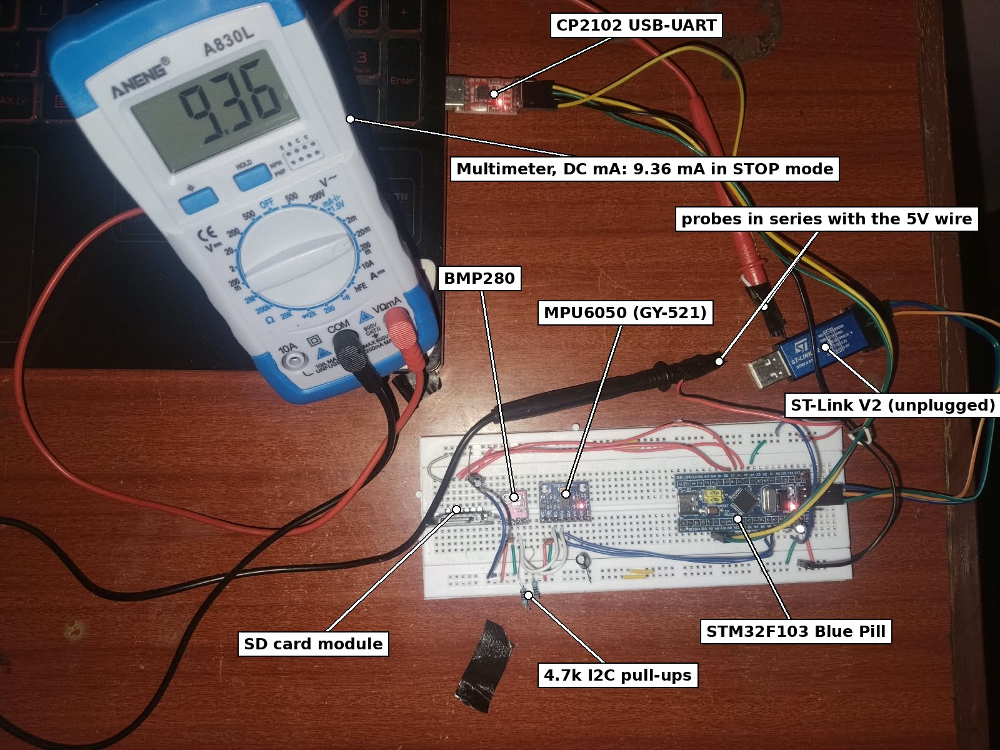

# Current measurements

## Procedure

Whole board measured at the 5 V input (Blue Pill, BMP280, GY-521, SD module).
Multimeter on DC mA, in series in the 5V wire:

```
CP2102 5V --> meter (mA) --> Blue Pill 5V pin
CP2102 GND -----------------> GND
```

1. Unplug the ST-Link and power cycle the board (with a debugger attached it never enters STOP).
2. Set the mode with the command from the table.
3. Wait 30 s without typing (after a key the board stays awake for 30 s), then read the meter.



## Results

19-10-2026, breadboard, logging at 1 sample/s, 115200 baud.

| # | Command | Mode | Current |
|---|---|---|---|
| 1 | `power run` | logging, CPU never sleeps | 17.62 mA |
| 2 | `power sleep` | logging, WFI between tasks | 12.94 mA |
| 3 | `power stop` | logging, STOP between samples | 9.3 mA |
| 4 | `stop` + `power stop` | not logging, STOP | 9.1 mA |
| 5 | as 4 + `mpusleep` | not logging, MPU6050 asleep | 7.92 mA |
| 6 | as 3, SD card removed | logging to UART only | 9.9 mA (avg) |

`power` after 3 min in mode 3: STOP 81 % of the time (including the 30 s awake after the
last key), about 96 % when nobody types.

## Interpretation

- STOP mode cuts the board current by 47 % (17.6 -> 9.3 mA).
- The chip itself is ~0.02 mA in STOP. What is left is the modules: MPU6050 (~1.2 mA, row 4 - row 5),
  the SD module's regulator, the power LEDs and the regulators.
- The PC13 LED takes ~1.7 mA. In STOP mode it only flashes during a sample.
- Row 6 is higher than row 3: without a card the LED blinks and the logger retries the card every 5 s.
- Battery estimate (18650, 2500 mAh, boost converter ~85 %): about 7 days in STOP mode,
  about 3.7 days in run mode.
- To go lower: remove the power LEDs, use a low-quiescent 3.3 V regulator instead of the SD module's
  AMS1117, and switch the SD card off between writes.
